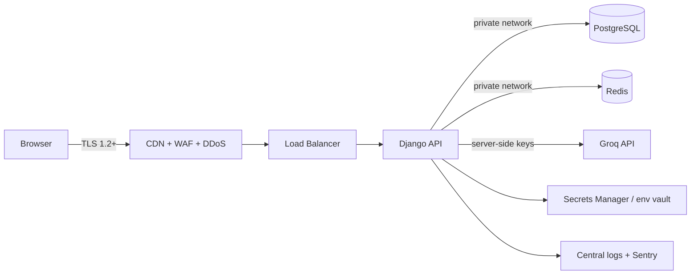

# Security Architecture

**Product:** Bharat Darshan 3D, a virtual explorer of Indian tourist places
**Version:** 1.0 | **Date:** 01 Nov 2026

---

## 1. Security Objectives
1. Protect user accounts and personal data (confidentiality, integrity).
2. Keep third-party API keys (Groq, Google) and secrets from leaking.
3. Prevent abuse of costly endpoints (AI chat, auth, asset delivery).
4. Keep the platform available under normal and hostile traffic.
5. Meet baseline privacy expectations, including India's Digital Personal Data Protection Act, 2023 (DPDP).

## 2. Data Classification
| Class | Examples | Handling |
|---|---|---|
| Confidential | Passwords (hashed), refresh tokens, API keys, secrets | Never logged; encrypted or hashed; restricted access |
| Personal | Email, name, avatar, visit history, chat content | Encrypted in transit, minimal retention, access controlled |
| Internal | Audit logs, analytics | Access limited to staff |
| Public | Place catalogue, descriptions, public media | Cacheable, CDN-served |

## 3. Threat Model (STRIDE Summary)
| Threat | Example | Primary Controls |
|---|---|---|
| Spoofing | Credential stuffing, stolen token | Rate limits, lockout, short-lived JWT, optional MFA |
| Tampering | Modified API payloads, scene manifest | Server-side validation, HTTPS, signed URLs |
| Repudiation | Disputed admin change | Audit log with actor, IP, timestamp |
| Information disclosure | Key leak, IDOR on visits/chats | Secrets manager, object-level permissions, no secrets in frontend |
| Denial of service | Request floods, AI endpoint abuse | WAF, throttling, queues, token budgets |
| Elevation of privilege | User reaches admin | RBAC, separate admin hardening, least privilege |

## 4. Security Architecture Overview

Zones: **Public** (CDN, load balancer), **Application** (API, workers), **Data** (DB, Redis; no public IP, security-group restricted).

## 5. Authentication
- **Passwords:** Django password validators (min length 10, common-password check). Hashing with Argon2id (fallback PBKDF2-SHA256 with high iterations).
- **JWT (SimpleJWT):**
  - Access token 10-15 min, kept in memory only (never localStorage).
  - Refresh token 7 days, stored in an HttpOnly, Secure, SameSite=Lax/Strict cookie, **rotated on every use**, old ones blacklisted.
  - Strong signing key from the secrets manager; `HS256` with a long random key, or `RS256` if separate verifiers are needed.
- **Google OAuth:** Verify the ID token server-side (signature, `aud`, `iss`, expiry); bind the account to the verified email.
- **Brute force:** Throttle login per IP and per account, progressive delay, temporary lockout, and generic error messages (no user enumeration).
- **Email verification** before the first visit (optional gate) and a **password reset** flow with single-use, 30-minute tokens.
- **MFA (v1.1):** TOTP for admin accounts first, then optional for users.

## 6. Authorization
- **Roles:** `visitor` (anonymous), `user`, `staff/editor`, `admin`.
- DRF permission classes enforce role checks at view level; object-level checks (owner only) on visits, favourites, chats, profile.
- Scene manifest and AI guide require authentication.
- No direct trust in client-supplied `user_id`; the user is always taken from the token.
- Admin panel: separate URL path, staff-only, strong passwords plus MFA, optional IP allowlist, all changes written to the audit log.

## 7. Transport and Network Security
- HTTPS everywhere; TLS 1.2+ with HSTS (`max-age` 1 year, includeSubDomains, preload when ready).
- Django settings: `SECURE_SSL_REDIRECT`, `SESSION_COOKIE_SECURE`, `CSRF_COOKIE_SECURE`, `SECURE_HSTS_*`.
- Database and Redis not exposed publicly; accessed over a private network only, with TLS where supported.
- Firewall/security groups: open only 80/443 at the edge; SSH by key only, from a bastion or VPN.

## 8. Web Application Protections
### 8.1 Security Headers
| Header | Value (guideline) |
|---|---|
| Content-Security-Policy | Restrict `script-src`, `connect-src`, `img-src`, `frame-src` to self, CDN, Google Maps, Google Fonts; no `unsafe-eval` unless required by a library |
| X-Content-Type-Options | `nosniff` |
| X-Frame-Options / `frame-ancestors` | `DENY` (or `self`) |
| Referrer-Policy | `strict-origin-when-cross-origin` |
| Permissions-Policy | Disable camera, mic, geolocation unless needed |
| Cross-Origin-Opener-Policy | `same-origin` |

### 8.2 Input and Output
- DRF serializers validate all input (types, lengths, enums, ranges).
- Django ORM only (parameterised queries) to prevent SQL injection; no raw SQL with string formatting.
- React escapes output by default; **never** use `dangerouslySetInnerHTML` with unsanitised data. AI answers are rendered as text or sanitised Markdown (DOMPurify).
- Uploads (admin only): validate extension and MIME type, size limits, store outside the web root, and scan if feasible.

### 8.3 CSRF and CORS
- Refresh cookie endpoint protected with SameSite plus a CSRF token or custom header check.
- CORS allowlist limited to the production frontend origins; no wildcard with credentials.

## 9. API Key and Secrets Management
| Secret | Where used | Rule |
|---|---|---|
| Groq API key | Backend only | Never sent to the browser; stored in the secrets manager or env vault; rotated on suspicion or schedule |
| Google Maps **browser** key | Frontend | Restrict by HTTP referrer **and** API (Maps JavaScript API only); budget alerts and quota caps |
| Google **server** key | Backend (optional) | Restrict by server IP and API (Geocoding/Places only) |
| Django `SECRET_KEY`, JWT signing key, DB password | Backend | Environment/secret store; never committed; different per environment |
- `.env` files are git-ignored; secret scanning (gitleaks) in CI and pre-commit.
- Principle of least privilege for each key; separate keys for dev, staging and prod.

## 10. Protecting the AI (Groq) Integration
- **Abuse control:** Per-user and per-IP throttles (e.g. 20 questions/hour), daily token budget, max input length (e.g. 500 chars), max output tokens, and a response cache.
- **Prompt injection:** The system prompt is fixed server-side; user content is passed only as the user message. Model output is never executed or trusted for decisions.
- **Data minimisation:** Send only the place context and the question to Groq; no email, name or other personal data.
- **Output handling:** Strip HTML, enforce a length cap, optional moderation check, and an "AI-generated" label in the UI.
- **Resilience:** Timeout, retries with backoff, circuit breaker, and a fallback to the stored description.
- **Privacy:** Chat logs are retained for a limited period (e.g. 30-90 days) and are deletable by the user.

## 11. Protecting 3D Assets and Scene Delivery
- Manifest endpoint requires authentication.
- Asset URLs are served via CDN with signed, short-lived URLs if assets are not meant for public reuse (note: assets delivered to a browser cannot be made fully copy-proof, so treat them as publicly viewable).
- Hotlink protection and bandwidth alerts on the CDN.
- Collision data and POI text come from the server; the client cannot alter stored visit data to gain anything, since visits have no privileged effect.

## 12. Rate Limiting and DoS Protection
| Endpoint group | Suggested limit |
|---|---|
| Login / register / reset | 5-10 per minute per IP, plus per account |
| Public place APIs | 120 per minute per IP |
| Authenticated APIs | 300 per minute per user |
| `/guide/ask/` | 20 per hour per user, plus a global cap |
- WAF rules with bot protection; request body size limits; connection timeouts at Nginx.
- Redis-backed counters for throttling.

## 13. Database and Data-at-Rest Security
- Dedicated DB user with least privilege; no superuser from the app.
- Encrypted disks/volumes and encrypted backups; backups tested for restore.
- Daily automated backups with 7-30 day retention; point-in-time recovery if available.
- Sensitive fields are not logged; PII access is limited and audited.

## 14. Logging, Monitoring and Incident Response
- **Audit log:** Logins, failed logins, password changes, admin changes, role changes.
- **Monitoring:** Sentry for errors; alerts on spikes in 401/403/429/5xx, Groq spend and Maps usage.
- **Logs:** Structured, with PII redacted, retained 90 days, tamper-restricted.
- **Incident runbook:** Detect, contain (rotate keys, revoke tokens), eradicate, recover, review. Users are notified of a breach as required by law.

## 15. Privacy and Compliance (DPDP-aligned)
- Collect only what is needed (email, display name, visit history).
- Clear consent at sign-up with a privacy policy and terms.
- User rights: view, correct and delete the account and data; export on request.
- Data retention schedule; delete inactive accounts and old chats after the defined period.
- No selling of data; analytics must be anonymised or aggregated.
- Cookie notice if non-essential cookies are used.

## 16. Secure SDLC
| Stage | Practice |
|---|---|
| Design | Threat modelling per feature; this document is reviewed each release |
| Code | PR reviews; linting (`ruff`, `eslint`); Bandit for Python security checks |
| Dependencies | Dependabot or Renovate; `pip-audit` and `npm audit` in CI; pinned versions |
| Build | Minimal Docker images, non-root user, image scanning (Trivy) |
| Test | Security-focused tests for auth, IDOR and throttling; OWASP ZAP baseline scan |
| Release | Secrets only from the vault; staged rollout; rollback plan |
| Ops | Regular patching, key rotation, backup restore drills |

## 17. Mapping to OWASP Top 10 (2021)
| Risk | Mitigation in this design |
|---|---|
| A01 Broken access control | RBAC, object-level permissions, deny by default |
| A02 Cryptographic failures | TLS, strong hashing, encrypted storage, secure cookies |
| A03 Injection | ORM, serializers, output escaping, CSP |
| A04 Insecure design | Threat model, abuse limits, fallback modes |
| A05 Security misconfiguration | Hardened prod settings, `DEBUG=False`, header policy, locked-down CORS |
| A06 Vulnerable components | Dependency scanning and updates |
| A07 Authentication failures | Throttling, rotation, MFA for admin, verified OAuth |
| A08 Integrity failures | Signed URLs, CI integrity, pinned dependencies |
| A09 Logging/monitoring failures | Audit log, alerting, Sentry |
| A10 SSRF | No user-supplied URLs fetched server-side; outbound allowlist for Groq and Google |

## 18. Production Hardening Checklist
- [ ] `DEBUG=False`, `ALLOWED_HOSTS` set, unique `SECRET_KEY`
- [ ] HTTPS, HSTS, secure cookies enabled
- [ ] CSP and other headers verified with a scanner
- [ ] CORS allowlist limited to the production frontend
- [ ] Groq key server-side only; Maps keys restricted with quotas
- [ ] Throttles active on auth and AI endpoints
- [ ] DB and Redis private; backups running and restore tested
- [ ] Admin protected with MFA and an audit trail
- [ ] Secret scanning and dependency audits in CI
- [ ] Privacy policy, terms and data deletion process published
