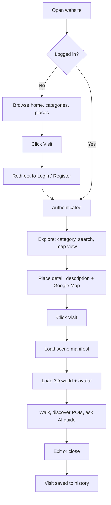
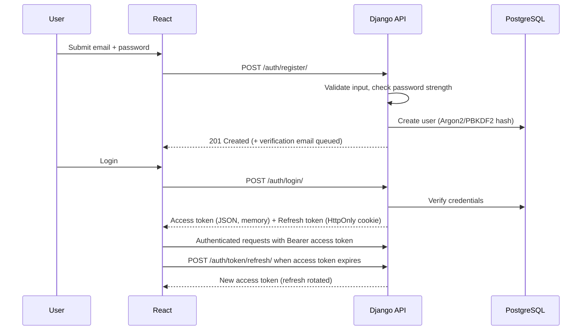
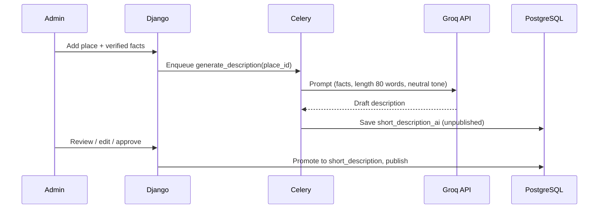
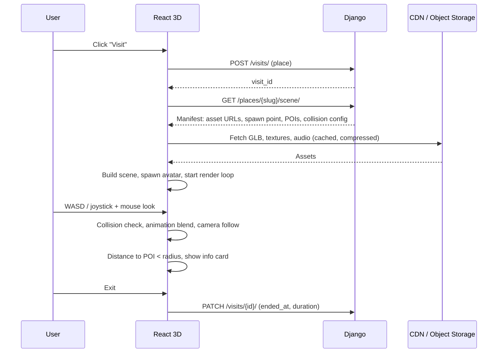
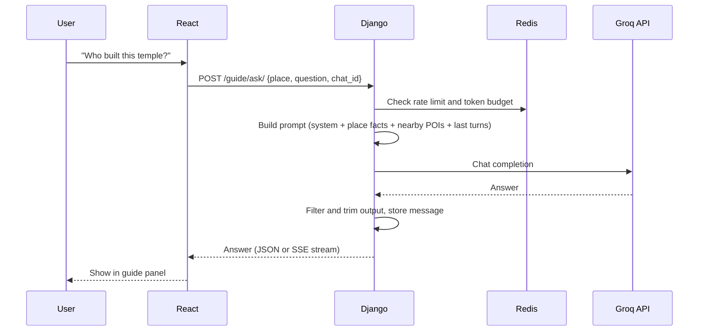

# System Workflow

**Product:** Bharat Darshan 3D, a virtual explorer of Indian tourist places
**Version:** 1.0 | **Date:** 01 Nov 2026

---

## 1. End-to-End User Journey

## 2. Registration and Login

**Google sign-in variant:** The frontend gets a Google ID token, sends it to `/auth/google/`, and the backend verifies it with Google, finds or creates the user, then issues the same JWT pair.

## 3. Place Discovery
1. Home loads categories from `GET /categories/`.
2. User picks a category or searches. The frontend calls `GET /places/?category=...&q=...`.
3. The explore page shows a card grid plus a map with clustered markers.
4. Clicking a card opens the detail page via `GET /places/{slug}/`.
5. The detail page shows the short description, state, best season, and the Google Map pin.

## 4. Short Description Generation (Admin, Offline)

## 5. Virtual Visit Flow

### In-Scene Loop (per frame)
1. Read input and compute the movement vector.
2. Physics step and collision resolution (stay inside bounds, no wall clipping).
3. Update avatar animation (idle, walk, run).
4. Update the follow camera.
5. Check POI proximity and show or hide info cards.
6. Update the minimap.
7. Render.

### Degraded Modes
| Condition | Behaviour |
|---|---|
| No WebGL2 / very weak device | Show the 360-degree panorama viewer |
| Slow network | Low-quality assets first, upgrade textures later |
| Scene asset fails to load | Retry, then show an error with a panorama or gallery fallback |

## 6. AI Guide Chat Flow

**Failure path:** On timeout or quota exhaustion the API returns a friendly message plus the stored place description. The UI stays usable.

## 7. Google Maps Flow
- The frontend loads the Maps JS API with the restricted browser key.
- The place coordinates come from the API, so the map is centred on them and a marker is dropped.
- "Open in Google Maps" builds a deep link from the coordinates or place name.
- Optional: the backend uses a separate server-restricted key for geocoding during admin entry. That key never goes to the browser.

## 8. Admin Workflow
1. Admin logs in to the Django admin (restricted by role and IP allowlist if possible).
2. Creates a Place: name, category, state, coordinates, facts.
3. Uploads or links assets (GLB, textures, audio, panorama).
4. Defines POIs (position, radius, text).
5. Triggers AI description, reviews, approves.
6. Publishes the place. The cache is invalidated and the place goes live.

## 9. Session and Token Lifecycle
| Token | Lifetime | Storage |
|---|---|---|
| Access JWT | 10-15 min | JS memory only |
| Refresh JWT | 7 days, rotated on each use | HttpOnly, Secure, SameSite cookie |
| Password reset token | 30 min, single use | Email link |

Logout blacklists the refresh token and clears the cookie.

## 10. Error Handling Conventions
| Case | HTTP | UI behaviour |
|---|---|---|
| Validation error | 400 | Inline field messages |
| Unauthenticated | 401 | Silent refresh once, else redirect to login |
| Forbidden | 403 | "No access" message |
| Not found | 404 | Friendly not-found page |
| Throttled | 429 | "Please wait" with retry timer |
| Upstream (Groq/Maps) failure | 502/503 | Fallback content, retry option |
| Server error | 500 | Generic message plus error ID for support |

## 11. Notifications and Analytics (v1 minimal)
- Emails: verification, password reset.
- Events logged: sign-up, login, place view, visit start and end, guide question count. These feed the success metrics in the PRD.
