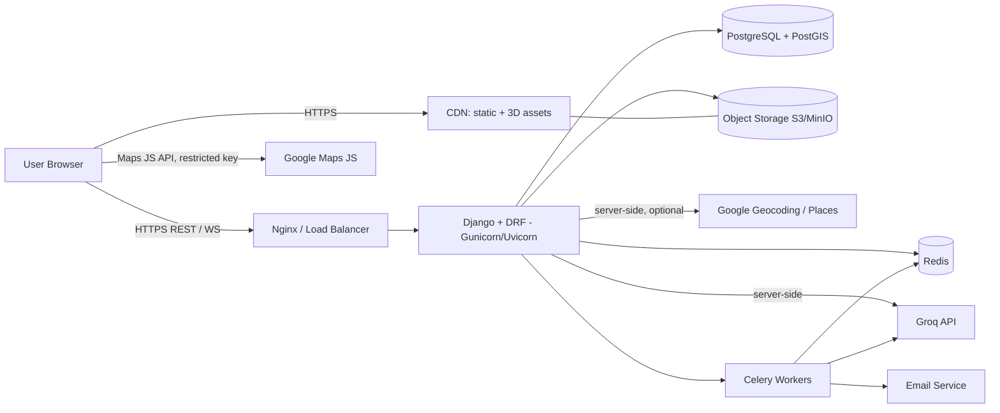
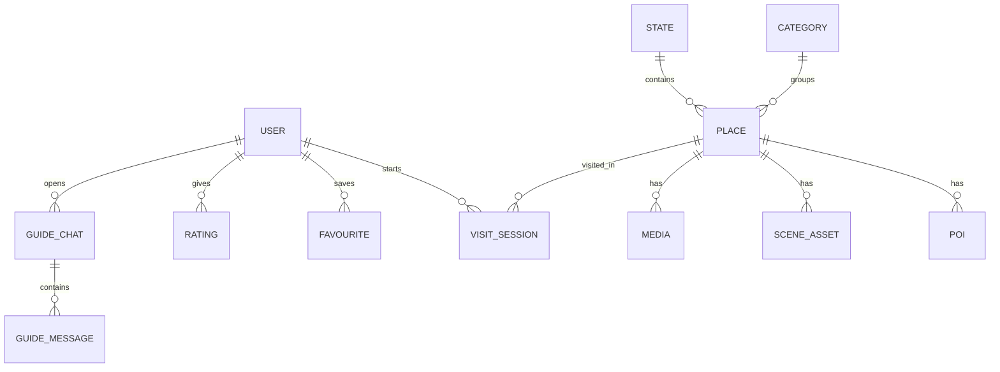
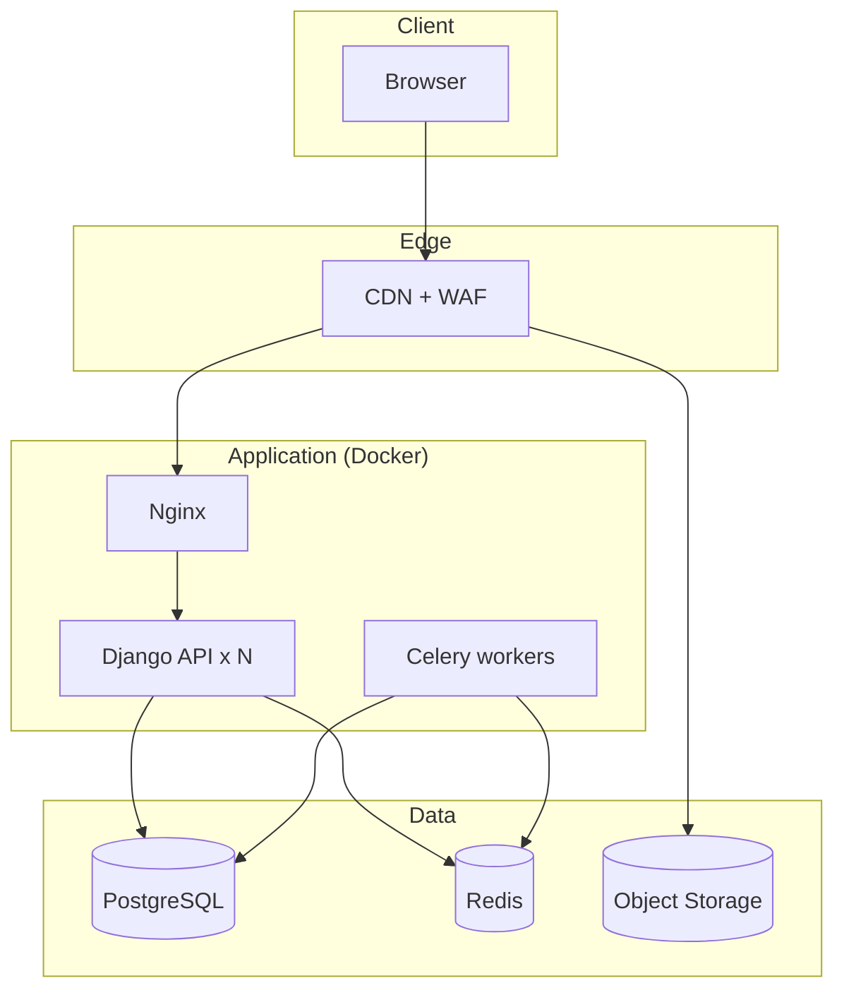

# Technical Architecture

**Product:** Bharat Darshan 3D, a virtual explorer of Indian tourist places
**Version:** 1.0 | **Date:** 01 Nov 2026

---

## 1. Architecture Overview
A decoupled three-tier web application:

- **Presentation:** React SPA with a Three.js (React Three Fiber) 3D engine and a spatial UI layer.
- **Application:** Django + Django REST Framework (DRF) API. It owns auth, places, AI calls and admin.
- **Data:** PostgreSQL (primary store), Redis (cache, rate limits, task broker), object storage plus CDN (3D assets, images, audio).

External services: Google Maps Platform, Groq API, SMTP provider, optional Google OAuth.



## 2. Frontend Architecture (React)

### 2.1 Layers
| Layer | Responsibility |
|---|---|
| Pages / routes | Home, Explore, Place Detail, Virtual Visit, Profile, Login/Register, Admin links |
| Spatial UI | Glass panels, parallax hero, floating category orbs, depth effects |
| 3D engine | Scene loading, character controller, camera, POI triggers, minimap |
| State | Server state via TanStack Query; client/UI state via Zustand |
| API client | Axios instance with JWT interceptor and silent refresh |

### 2.2 Suggested Folder Structure
```
frontend/
  src/
    app/                 # router, providers, layout
    features/
      auth/              # login, register, guards
      places/            # list, filters, detail
      map/               # Google Map components
      guide/             # Groq chat panel
      visit/             # 3D world
        scene/           # SceneLoader, Lighting, Terrain, Sky
        character/       # Avatar, controller, animations
        poi/             # hotspots, info cards
        hud/             # minimap, controls, settings
    components/ui/       # spatial UI primitives
    lib/                 # api client, auth, utils
    styles/              # theme tokens, Tailwind config
```

### 2.3 3D Visit Engine
- **Rendering:** React Three Fiber + drei (glTF loader, Environment, Sky, KeyboardControls, Html overlays).
- **Character:** glTF avatar with Idle/Walk/Run animations; third-person follow camera; WASD, arrow keys, or touch joystick.
- **Physics/collision:** Rapier (`@react-three/rapier`) with simplified collision meshes. Navmesh optional later.
- **Asset pipeline:** Blender to glTF/GLB, then Draco compression and KTX2 textures, then CDN. Scenes are chunked with LOD.
- **Streaming:** Show a loading screen with progress while the main scene loads; lazy-load far chunks.
- **POIs:** Each scene has POI anchors (position, radius, title, text, optional audio). Entering the radius shows an info card.
- **AI guide:** A side panel sends the question plus the place and POI context to the backend, which calls Groq.
- **Fallback:** If WebGL2 is unavailable or the device is weak, show a 360-degree panorama viewer.
- **Quality presets:** Low, Medium, High (shadows, resolution scale, draw distance, post-processing).

### 2.4 Google Maps on the Frontend
- `@vis.gl/react-google-maps` renders the map.
- Browser key is restricted by HTTP referrer and limited to the Maps JavaScript API.
- Explore page uses marker clustering; detail page shows a single pin plus nearby context.

## 3. Backend Architecture (Django)

### 3.1 Apps
| Django app | Purpose |
|---|---|
| `accounts` | Custom user model, JWT auth, OAuth, profile, password reset |
| `places` | Place, Category, State, Media, POI, SceneAsset |
| `visits` | VisitSession, Favourite, Rating, history |
| `guide` | Groq integration, prompt builder, chat sessions, usage limits |
| `maps_api` | Optional server-side geocoding and place metadata helpers |
| `core` | Shared utils, permissions, throttles, audit log, health checks |

### 3.2 Backend Structure
```
backend/
  config/ (settings/base.py, dev.py, prod.py, urls.py, asgi.py, wsgi.py)
  apps/
    accounts/  places/  visits/  guide/  maps_api/  core/
  services/
    groq_client.py       # wrapper with retries, timeouts, caching
    storage.py           # S3/MinIO signed URLs
  tasks/                 # Celery tasks
  tests/
```

### 3.3 API Surface (REST, versioned `/api/v1/`)
| Method | Endpoint | Auth | Description |
|---|---|---|---|
| POST | `/auth/register/` | Public | Create account |
| POST | `/auth/login/` | Public | Issue JWT pair |
| POST | `/auth/token/refresh/` | Cookie/refresh | New access token |
| POST | `/auth/logout/` | User | Blacklist refresh token |
| POST | `/auth/google/` | Public | Exchange Google ID token |
| POST | `/auth/password-reset/` | Public | Request reset email |
| GET | `/me/` | User | Profile |
| PATCH | `/me/` | User | Update profile |
| GET | `/categories/` | Public | List categories |
| GET | `/places/` | Public | List with filters (`category`, `state`, `q`, `page`) |
| GET | `/places/{slug}/` | Public | Detail with short description and coordinates |
| GET | `/places/{slug}/scene/` | User | Scene manifest: signed asset URLs, spawn point, POIs, collision config |
| POST | `/visits/` | User | Start visit session |
| PATCH | `/visits/{id}/` | User | End session or update progress |
| GET/POST/DELETE | `/favourites/` | User | Manage favourites |
| POST | `/guide/ask/` | User | Ask the AI guide (rate limited) |
| GET | `/health/` | Public | Liveness/readiness |

Documented with OpenAPI (drf-spectacular).

### 3.4 Groq Integration Design
- Called only from the backend through `services/groq_client.py`.
- **Description generation (offline/admin):** A Celery task builds a prompt from verified place facts (name, state, category, history notes) and requests a short description of roughly 80 words. The result is saved to `Place.short_description_ai` and promoted after admin review.
- **Guide chat (online):** The system prompt scopes the assistant to the current place. Context is the place facts plus nearby POI text. History is limited to the last N turns. Streaming responses are optional (SSE).
- **Controls:** Timeout of about 15 s, 2 retries with backoff, per-user and per-IP throttles, daily token budget, response cache for repeated questions, and a stored-description fallback on failure.
- **Model name:** Read from an environment variable so it can be swapped without code changes.
- **Safety:** Prompt injection is mitigated by treating user text as data, keeping the system prompt separate, capping output length, and filtering output.

### 3.5 Scene Delivery
`GET /places/{slug}/scene/` returns a manifest only. The 3D files live in object storage behind the CDN. The manifest contains short-lived signed URLs (or public immutable URLs for non-sensitive assets), so the API never streams large files.

## 4. Data Architecture (PostgreSQL)



### Core Tables
| Table | Key fields |
|---|---|
| `user` | id (UUID), email (unique), password_hash, display_name, avatar_url, auth_provider, is_active, created_at |
| `category` | id, name, slug, icon, theme_color |
| `state` | id, name, code |
| `place` | id, slug, name, category_id, state_id, short_description, short_description_ai, latitude, longitude (or PostGIS `geom`), best_season, is_published, scene_mode (`3d` / `panorama`), created_at |
| `poi` | id, place_id, title, body, pos_x, pos_y, pos_z, radius, audio_url |
| `scene_asset` | id, place_id, kind (glb, hdr, audio, panorama), storage_key, version, size_bytes |
| `media` | id, place_id, image_url, caption, credit |
| `visit_session` | id, user_id, place_id, started_at, ended_at, duration_s, device_info |
| `favourite` | user_id, place_id, created_at (unique pair) |
| `rating` | user_id, place_id, score (1-5), comment |
| `guide_chat` / `guide_message` | chat id, user_id, place_id; messages with role, content, tokens, created_at |
| `audit_log` | id, actor_id, action, target, ip, created_at |

**Indexes:** unique `place.slug`; btree on `(category_id, state_id)`; GIN trigram on `place.name` for search; GiST on `geom` if PostGIS is used; `visit_session(user_id, started_at)`.

## 5. Caching and Async
- **Redis:** Cache for place lists/details (short TTL, invalidated on admin change), throttle counters, Celery broker.
- **Celery:** AI description generation, email sending, analytics aggregation, scene manifest pre-signing if needed.

## 6. Deployment Architecture

- **Containers:** `frontend` (static build served by CDN or Nginx), `api`, `worker`, `nginx`, `postgres`, `redis`.
- **Environments:** local (Docker Compose), staging, production.
- **CI/CD:** GitHub Actions runs lint, tests, build and image push, then deploys to staging, and to production after approval.
- **Hosting options:** a single VPS with Docker Compose for MVP; later a managed platform (AWS ECS/RDS, or Render/Railway) as load grows.
- **Observability:** Sentry (frontend and backend), structured JSON logs, uptime monitor on `/health/`, basic Prometheus/Grafana optional.

## 7. Performance Strategy
- Draco and KTX2 compressed assets, LOD, instancing for repeated objects, baked lighting where possible.
- HTTP caching with long-lived immutable asset URLs (content hash in filename).
- API pagination, `select_related` / `prefetch_related`, DB indexes.
- Code-splitting so the 3D bundle loads only on the Visit route.
- Lighthouse and frame-time budgets in CI for the 2D pages.

## 8. Scalability Notes
- API is stateless, so it scales horizontally behind the load balancer.
- Heavy assets are offloaded to the CDN, so API load stays small.
- Read replica for PostgreSQL if reads dominate.
- Groq calls are isolated behind rate limits and queues so spikes cannot starve the API.

## 9. Testing Strategy
| Level | Tools |
|---|---|
| Backend unit/API | pytest, pytest-django, DRF test client |
| Frontend unit/component | Vitest, React Testing Library |
| E2E | Playwright (login, browse, visit start) |
| 3D smoke | Headless load test of scene manifests, FPS sample on reference device |
| Security | Dependency audit (`pip-audit`, `npm audit`), OWASP ZAP baseline |
